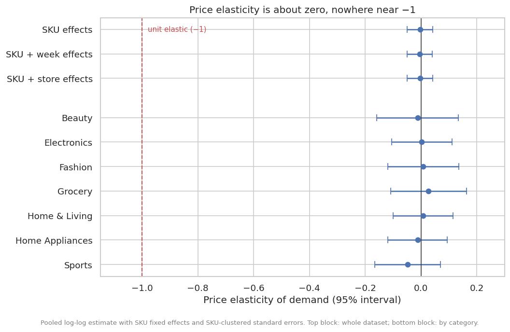
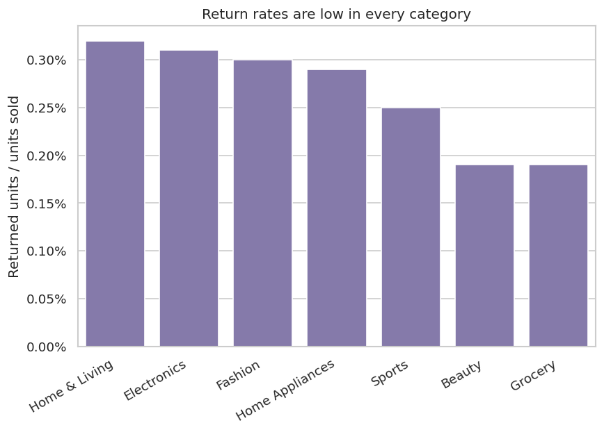

# Retail Promotion & Profitability Analytics

[](https://github.com/Abu-Hozaifa-Retail-Analyst/retail-promo-analytics/actions/workflows/ci.yml)


> **Key finding.** In this dataset, discounts do not measurably change how much customers buy:
> pooled price elasticity is **−0.003 (95% CI −0.049 to +0.042)**. To pay for themselves, a 5% discount
> would need about **+22% more volume**, a 10% discount **+58%**, a 15% discount **+121%** and a 20%
> discount **+269%**. Discounts total **37.3M SAR, equal to 22.3% of realized profit**. Capping discounts
> at 10% would add about **5.9M SAR (+3.5%)** if volume does not react, and still pays unless demand is more
> price-sensitive than **−6.4**. Whether discounts bring in extra transactions cannot be observed in this data.
>
> For a decision-oriented write-up, see [`STAKEHOLDER_SUMMARY.md`](STAKEHOLDER_SUMMARY.md).

## Questions this project answers

1. **Can this dataset support a promotion-effect analysis at all?** (data diagnostics)
2. **Do discounts change what customers buy?** (demand response and price elasticity)
3. **What do discounts cost?** (margin given away)
4. **How much extra volume would each discount depth need to pay for itself?** (break-even analysis)
5. **What would a discount cap do to profit?** (scenario simulation)

## Findings

| Question | Result | Code |
|---|---|---|
| Is there a promo calendar? | **No.** 54.7% of transactions carry a discount, flat across category, region, store type, weekday and month (spread ≤ 1.5 pts). P(promo \| previous transaction was promo) = 0.544 vs 0.551 otherwise, so discounting behaves like an independent per-transaction coin flip, not planned events. | `diagnostics.py` |
| Is the SKU × day panel dense? | **No.** 72.3% of SKU-days have zero sales; days with sales average 1.17 transactions. | `diagnostics.py` |
| Does quantity per transaction rise with a discount? | **No.** 3.003 units on promo vs 3.008 off promo: lift −0.15%, 95% CI [−0.69%, +0.39%]. | `diagnostics.py` |
| What is the price elasticity? | **−0.003, 95% CI [−0.049, +0.042]**, from 118,664 transactions and 500 SKUs. Unchanged with week effects (−0.004) or store effects (−0.003). All 7 categories have intervals that include 0 and exclude −1. | `pooled_elasticity.py` |
| What do discounts cost? | **37.3M SAR given**, 22.3% of 167.3M SAR profit. | `breakeven.py` |
| Could removing discounts pay off? | If every discount were removed, up to **33.5% of the promoted volume** could be lost before profit fell below today's level (illustrative: assumes the customers who leave are average). | `breakeven.py` |
| Are any sales below cost? | 2,046 promo transactions (3.2% of promo sales) were sold at or below cost. The money involved is small (0.34M SAR, 0.2% of profit), so this is a pricing-guardrail issue; most of the cost of discounting is the margin given away on ordinary discounts. | `breakeven.py` |
| What would capping discounts do? | A 10% cap adds **+5.9M SAR (+3.5%)** with no volume response, +4.7M at elasticity −1 and +2.7M at −3. Capping pays unless demand is more elastic than −6.4 (10% cap), −4.4 (no discounts), −5.2 (5% cap) or −8.5 (15% cap). See the scenario table below. | `scenarios.py` |
| Do returns matter? | No. Return rates are 0.19–0.32% by category. | `returns.py` |

### Break-even by discount depth

A discount of depth *d* on a product with margin *m* at list price leaves a profit of *(m − d)* per unit of
list price instead of *m*, so volume must rise by *d / (m − d)* just to keep profit flat. In dollars this is
`discount given / profit actually earned`, which stays exact when a band mixes products with different margins.

| Discount | Transactions | Margin at full price | Volume lift needed to hold profit flat | Basket-size lift observed (95% CI) | Sold at or below cost |
|---|---|---|---|---|---|
| 5% | 29,538 | 27.3% | +22% | −0.30% (−0.97% to +0.37%) | 0 |
| 10% | 21,248 | 27.3% | +58% | −0.09% (−0.84% to +0.66%) | 101 (0.5%) |
| 15% | 9,370 | 27.4% | +121% | +0.13% (−0.90% to +1.16%) | 809 (8.6%) |
| 20% | 4,772 | 27.4% | +269% | −0.04% (−1.42% to +1.35%) | 1,136 (23.8%) |

The observed column measures quantity per transaction. Any gap between it and the needed lift would have to
come from **extra transactions**, which this dataset cannot show.

### Discount-cap scenarios

A cap of *c* leaves every sale discounted at or below *c* untouched. A sale discounted deeper than *c* is
re-priced to *c*, and its volume reacts as `((1 − c) / (1 − d)) ^ elasticity`. Because the estimated elasticity
only covers basket size (not customers who stop coming), results are shown across a range of elasticities.

Profit change versus today (current profit 167.3M SAR):

| Cap | Sales re-priced | No response (ε = 0) | ε = −0.5 | ε = −1 | ε = −2 | ε = −3 | Break-even ε |
|---|---|---|---|---|---|---|---|
| 0% (no discounts) | 64,928 (100%) | +37.3M (+22.3%) | +32.1M | +27.1M | +18.1M | +10.0M | −4.4 |
| 5% | 35,390 (54.5%) | +16.9M (+10.1%) | +14.9M | +13.0M | +9.3M | +6.1M | −5.2 |
| 10% | 14,142 (21.8%) | +5.9M (+3.5%) | +5.3M | +4.7M | +3.7M | +2.7M | −6.4 |
| 15% | 4,772 (7.3%) | +1.5M (+0.9%) | +1.4M | +1.3M | +1.1M | +0.9M | −8.5 |

The break-even elasticity is the demand response at which a cap stops paying: capping adds profit unless
demand is *more* price-sensitive than this. All four values are far beyond the elasticity this data shows
(−0.003, with a 95% interval of −0.049 to +0.042).

**Read with care.** This is a model, not a forecast. It assumes one constant elasticity for every re-priced
sale and ignores effects on other products (traffic that buys full-price items), customer loyalty over time,
and competitor reactions. Removing all discounts is the extreme case; a partial cap is the safer first test.

### What this data cannot tell us

- **Traffic effects.** Quantity per transaction does not respond to discounts, but a discount could still
  bring in *more transactions*. Transactions only exist when a sale happened, and discounts are assigned
  per transaction rather than per period, so the extra transactions a discount might create cannot be
  observed here.
- **Anything about planned promotions.** There is no promo calendar in the data (see the first row above).

**What would fix it:** a promotion calendar from the planning system (SKU, store, start and end date,
mechanic), joined to the sales data, so promo periods can be compared with comparable non-promo periods.

## How the analysis works

```
raw CSVs ──► loader ──► cleaning (flag, don't drop) ──► analysis table ──┬──► diagnostics
                                                                         ├──► pooled elasticity
                                                                         ├──► break-even
                                                                         └──► discount-cap scenarios
```

1. **Load** the five star-schema tables (`src/data/loader.py`).
2. **Clean** `fact_sales`: deduplicate, flag invalid rows, separate returns, recompute financial fields
   (`src/data/cleaning.py`).
3. **Build the analysis table**: join dimensions and derive `is_promo` and `discount_pct`
   (`src/features/build_features.py`).
4. **Diagnose** whether the data can support a promotion-effect analysis
   (`src/analysis/diagnostics.py`).
5. **Estimate** one price elasticity with SKU fixed effects and SKU-clustered standard errors
   (`src/analysis/pooled_elasticity.py`).
6. **Break even**: compare the volume lift each discount depth needs with the lift observed
   (`src/analysis/breakeven.py`).
7. **Simulate** discount caps across a range of elasticities and solve for the break-even elasticity
   (`src/analysis/scenarios.py`).

## Project structure

```
retail-promo-analytics/
├── .github/workflows/ci.yml        # run tests on every push to main and on pull requests
├── src/
│   ├── data/
│   │   ├── loader.py               # read raw CSVs from data/raw/
│   │   └── cleaning.py             # dedup, validity flags, canonical recompute, QA summary
│   ├── features/
│   │   └── build_features.py       # joins, is_promo, discount_pct, depth buckets
│   ├── analysis/
│   │   ├── diagnostics.py          # can the data support a promo analysis?
│   │   ├── pooled_elasticity.py    # fixed-effects elasticity, clustered standard errors
│   │   ├── breakeven.py            # required vs observed volume lift, discount cost summary
│   │   ├── scenarios.py            # discount-cap simulation, break-even elasticity
│   │   └── returns.py              # return rate and net profit impact
│   ├── utils/parallel.py           # joblib wrapper for independent per-group work
│   ├── visualization.py            # break-even, elasticity, scenario and return-rate charts
│   └── pipeline.py                 # load -> clean -> analyze -> save tables -> draw charts
├── tests/                          # 47 pytest tests
├── docs/figures/                   # charts shown in this README
├── data/raw/                       # your 5 source CSVs go here (gitignored)
├── outputs/                        # generated tables and charts (gitignored)
├── pytest.ini
├── requirements.txt
├── STAKEHOLDER_SUMMARY.md          # decision-oriented summary of the findings
└── LICENSE
```

## Setup

Python 3.11 or newer (CI runs 3.11; developed on 3.13).

```powershell
python -m venv .venv
.venv\Scripts\Activate.ps1          # macOS/Linux: source .venv/bin/activate
pip install -r requirements.txt
```

## Data expectations

Place these five CSVs in `data/raw/` (star schema, not included in the repo):

| File | Grain | Key columns |
|---|---|---|
| `dim_customer.csv` | 1 row / customer | `customer_id`, `customer_segment`, `gender`, `age`, `city` |
| `dim_date.csv` | 1 row / calendar date | `date_key`, `date`, `year`, `quarter`, `month`, `week` |
| `dim_product.csv` | 1 row / SKU | `product_id`, `category`, `unit_cost`, `selling_price` |
| `dim_store.csv` | 1 row / store | `store_id`, `region`, `store_type` |
| `fact_sales.csv` | 1 row / transaction line | `transaction_id`, `transaction_date`, `customer_id`, `product_id`, `store_id`, `quantity`, `unit_price`, `discount_amount`, `unit_cost` |

There is no explicit promo flag. A transaction counts as **promoted** if `discount_amount > 0`
(defined in `src/features/build_features.py`). The diagnostics above show that, in this dataset,
that is a per-transaction attribute rather than a promotion event.

## Data quality handling

Real POS data has issues. They are handled explicitly rather than silently:

| Issue | Handling |
|---|---|
| Duplicate `transaction_id` | Deduplicated (keep first) |
| Bad `product_id` / `store_id` foreign key, zero quantity, non-positive price, date outside calendar | **Kept**, flagged `is_valid=False` with a reason in `invalid_reasons`; excluded only from aggregates |
| Discount larger than the gross sale (over 100% off) on a normal sale | **Kept**, flagged `is_valid=False` (`discount_exceeds_gross`). It makes net sales negative, so it is a data error, not a promotion |
| Negative quantity | Treated as a **return** (`is_return=True`), not a data error: kept valid, analyzed separately |
| `customer_id` present but not in `dim_customer` | **Kept**, flagged `has_valid_customer=False` (separate from `is_valid`, since a bad customer link does not affect revenue or margin math, only customer-level cuts) |
| Provided `gross_sales`, `net_sales`, `profit_amount`, `gross_margin_pct` | **Recomputed** from base fields; disagreements flagged `qa_mismatch=True` |

Results on this dataset:

| Metric | Value |
|---|---|
| Raw rows | 120,680 |
| Duplicate rows removed | 680 |
| Invalid rows (excluded from aggregates) | 1,041 (345 of them for a discount above 100%) |
| Valid rows | 118,959 |
| Return rows (kept, analyzed separately) | 296 |
| Valid non-return transactions in the analysis table | 118,664 |
| Financial field mismatches (source vs recomputed) | 495 to 1,087 depending on field |

The pipeline writes the full report to `outputs/reports/qa_report.md`.

## Running the analysis

```powershell
python -m src.pipeline
```

One command loads and cleans the data, runs the diagnostics, pooled elasticity, break-even analysis,
discount-cap scenarios and return rates, then writes every table to `outputs/reports/` and four charts to
`outputs/figures/`. It takes about five seconds on this dataset.

Always use `python -m src.pipeline`, not `python src/pipeline.py`. The `-m` flag puts the project root
on the import path so `from src...` imports resolve.

| Output (in `outputs/reports/`) | Contents |
|---|---|
| `qa_report.md`, `qa_report.json` | Data-quality counts from cleaning |
| `diagnostics_summary.json` | Promo share, panel sparsity, persistence, demand response, discount cost summary |
| `promo_assignment.csv`, `demand_by_depth.csv` | Promo share by dimension; quantity and margin by discount depth |
| `pooled_elasticity.csv`, `pooled_elasticity_by_category.csv` | Elasticity with 95% intervals (three specifications; by category) |
| `breakeven.csv` | Required vs observed volume lift for each discount depth |
| `scenario_grid.csv`, `scenario_curve.csv`, `breakeven_elasticity.csv` | Discount-cap results, the curves behind the chart, and break-even elasticities |
| `return_rate_category.csv` | Return rate and net profit impact by category |

Files in `outputs/` from earlier versions of the pipeline (for example `promo_lift_*.csv` or
`promo_profitability_scatter.png`) are not overwritten. Delete them before the first run so stale legacy
results cannot be mistaken for current ones.

To use the results from a notebook:

```python
from src.pipeline import run_full_pipeline

results = run_full_pipeline(make_charts=False)
results["breakeven"]  # required vs observed lift by discount depth
results["scenario_grid"]  # caps x elasticities
results["discount_cost"]  # total discounts, share of profit, below-cost sales
results["analysis_df"]  # the transaction-level analysis table
```

### Charts

Generated into `outputs/figures/` by `src/visualization.py`; the copies below are committed in
`docs/figures/`. Caveats are written onto the charts so they travel with the image.







## Methodology review: what the first version got wrong

The first version of this project compared "promo days" with "non-promo days" for each SKU or category. A
review found problems that made its headline numbers (20.2M SAR lost, "0 of 500 SKUs profitable")
unreliable, so that code was removed and replaced by the analyses above. It remains in the git history.

| What went wrong | Why it mattered |
|---|---|
| The daily grouping only created rows for days that had a sale | 72% of SKU-days were ignored, and "units per day" was effectively quantity per transaction |
| Promo status is set per transaction | One calendar day could fall into both regimes, and there are no real promo periods to compare |
| Category-level lift compared buckets of unequal size (about 55% vs 45% of transactions) | It showed positive lift for every category and contradicted the SKU level; it was an artifact |
| SKU-level "negative revenue lift" mostly reflected the discount itself | Revenue per transaction is 9.9% lower on promos against an average depth of 9.2%, because quantity does not respond |
| Incremental-profit totals depended on the grouping | The same code gave 18.9M SAR at category level and 36.2M SAR at SKU level, so neither was a reliable headline |
| Per-SKU elasticity regressions used about 240 transactions each | Estimates were noise around zero (only 2% significant); replaced by the pooled estimate |

The old headline "0 of 500 SKUs ran a profitable promotion" followed mechanically from the fourth row:
with no quantity response, profit per transaction must fall by the discount. It described the data, not
a finding about promotion strategy.

## Testing

```powershell
pytest -v
```

47 tests:

| File | Tests | Covers |
|---|---|---|
| `test_cleaning.py` | 13 | One test per data-quality rule, QA summary |
| `test_build_features.py` | 4 | Promo derivation, joins, default exclusions |
| `test_parallel.py` | 4 | Grouping, key handling, filtering |
| `test_returns.py` | 1 | Return rate against the shared fixture |
| `test_diagnostics.py` | 5 | Sparsity, assignment profile, persistence, demand response |
| `test_pooled_elasticity.py` | 4 | Known elasticity recovered, zero response, and week effects removing seasonal confounding |
| `test_breakeven.py` | 6 | Depth snapping, textbook break-even formula, below-cost, extra traffic needed, per-group margins, cost summary |
| `test_pipeline.py` | 2 | End-to-end run on a synthetic star schema with planted problems: every table and chart is written, QA counts match, and the cap-of-zero identity holds |
| `test_scenarios.py` | 8 | Exact gain with no response, untouched sales, volume reaction, unit elasticity leaves revenue unchanged, cap of zero, closed-form break-even elasticity, grid shape |

The pooled elasticity tests use data generated from a **known** elasticity. One test builds busy weeks
that have both more discounting and more demand: the naive estimate is −3.6 against a true −1.0, and
adding week effects recovers −0.98.

## Continuous integration

GitHub Actions (`.github/workflows/ci.yml`) runs the full test suite on every push to `main` and on every
pull request targeting `main`, on Python 3.11. The suite includes an end-to-end pipeline test on a small
synthetic dataset, because the real data is gitignored.

## Lessons learned

- pandas and NumPy return their own boolean type (`np.bool_`), so `is True` fails on correct values. Use
  `assert x` or `assert not x`.
- `np.isclose` defaults are far tighter than typical rounding; pass an explicit `atol`.
- When a shared fixture in `conftest.py` changes, every test that uses it needs re-checking.
- Only third-party packages belong in `requirements.txt`. `json`, `logging` and `pathlib` ship with Python.
- Aggregation can hide the truth: always check how much of the panel is empty and how many events each
  group contains before trusting a daily average.
- Look at the tails of every numeric column. About 190 transactions with discounts above 100% went
  unnoticed until discounts were banded by depth.
- Seasonality inflates promo effects: when busy weeks have both more discounts and more demand, a naive
  elasticity looks far too large. Fixed effects fix it.
- Cluster-robust standard errors are only well calibrated with enough clusters (about 100 here vs 20).
- Check simulations against identities you already know: removing every discount with no volume change must
  gain exactly the total discounts, and unit elasticity must leave net sales unchanged.
- If the real data is gitignored, CI never runs the pipeline. Add an end-to-end test on a small synthetic
  dataset with planted problems (a duplicate, an over-100% discount, a return) so a broken pipeline cannot merge.
- Look at every chart before shipping it. A clipped axis label, an overlapping annotation and a label drawn
  outside the plot area all passed the code and were only visible in the image.
- Delete code you know is wrong instead of keeping it "for reference". Keep the lesson in the docs and the
  code in git history.
- Work in dollars, not ratios: a median of per-transaction break-even ratios understates the lift needed,
  because low-margin products carry most of the discount dollars.

## Roadmap

- [x] Loader, cleaning, feature engineering, parallel utility
- [x] First-version analyses (lift, erosion, ranking, per-SKU elasticity), later removed after a methodology review
- [x] Tests and CI
- [x] Data diagnostics
- [x] Pooled fixed-effects elasticity
- [x] Break-even analysis and below-cost check
- [x] Discount-cap scenario simulation with break-even elasticity
- [x] Wire diagnostics, pooled elasticity, break-even and scenarios into the pipeline and rebuild the charts
- [x] Remove the superseded first-version code and rewrite `STAKEHOLDER_SUMMARY.md`
- [ ] SKU × week traffic panel (only informative once a promo calendar is available)
- [ ] Input schema validation
- [ ] Engineering polish: `pyproject.toml`, ruff, mypy, coverage, Python version matrix
- [ ] Notebook walkthrough
- [ ] Repository description and topics, `v1.0` release

## License

MIT. See [LICENSE](LICENSE).
