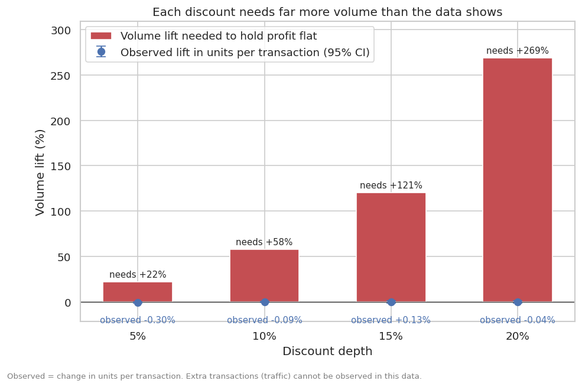
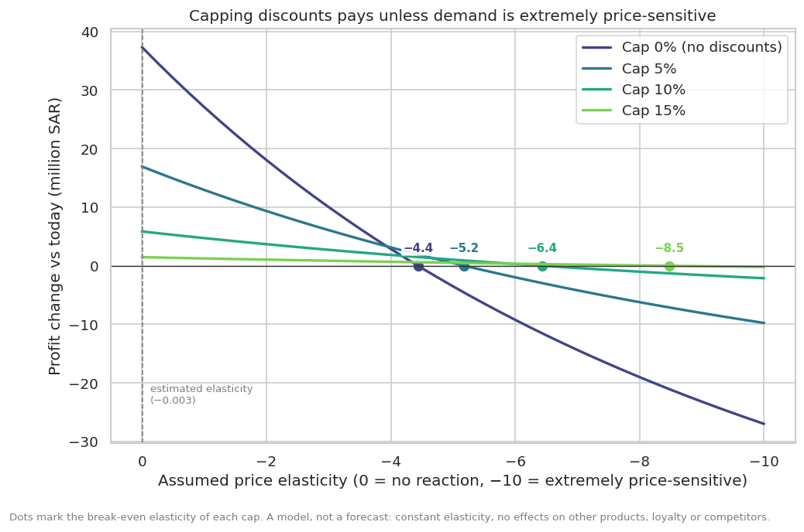

# Promotion & Profitability Analysis: Summary for Decision-Makers

**Data:** 118,664 sales lines ("sales") across 500 products and 20 stores, January 2024 to December 2025.
Net sales were 710.4M SAR and profit was 167.3M SAR. All amounts are in SAR.

## The short version

- **Discounts cost 37.3M SAR of margin, equal to 22.3% of profit.**
- **Customers buy the same quantity with or without a discount** (3.0 units per sale at every discount
  level). Each discount is therefore margin given away, unless it also brings in extra customers. This
  data cannot show whether it does.
- **Recommendation:** stop discounts that sell below cost now, and test a 10% discount cap in half of
  the stores for 8 to 12 weeks. If customers do not react, the cap adds about **5.9M SAR (+3.5%)** to profit.

## Discounts do not change what customers buy

| Discount | Sales | Units per sale | Profit per sale |
|---|---|---|---|
| None | 53,736 | 3.01 | 1,732 SAR |
| 5% | 29,538 | 3.00 | 1,406 SAR |
| 10% | 21,248 | 3.00 | 1,092 SAR |
| 15% | 9,370 | 3.01 | 776 SAR |
| 20% | 4,772 | 3.01 | 459 SAR |

Quantity per sale stays flat while profit per sale falls with every step. We also measured how quantity
responds to price across all 500 products: **a 10% price cut changes quantity by about 0.03%, give or take
half a percent.** The result is the same when we account for busy and quiet weeks, for differences between
stores, and within each of the 7 product categories.

## How much extra volume each discount would need

At a 27% margin at full price, a 10% discount removes more than a third of the profit on every sale it
touches (10 of the 27 points). Volume would have to rise to make that back:

| Discount | Extra volume needed to keep profit flat | Observed change in units per sale | Sales priced at or below cost |
|---|---|---|---|
| 5% | +22% | −0.30% | 0 |
| 10% | +58% | −0.09% | 101 (0.5%) |
| 15% | +121% | +0.13% | 809 (8.6%) |
| 20% | +269% | −0.04% | 1,136 (23.8%) |

## How discounting is being used

- **54.7% of all sales carry a discount**, and the share is nearly identical across categories, regions,
  store types, weekdays and months (within 1.5 points). A product discounted on one sale is no more likely
  to be discounted on its next one (54.4% vs 55.1%). This looks like routine discounting at the till, not
  targeted promotions.
- **2,046 sales were priced at or below cost**: 3.2% of discounted sales, and almost a quarter of those
  discounted 20%. The money is small (0.34M SAR), but it points to a missing guardrail.
- **Returns are not a factor.** Return rates are 0.19% to 0.32% of units in every category.

## What a discount cap would do

A cap leaves every sale discounted at or below the cap untouched and re-prices deeper discounts to the cap.

| Cap | Discounted sales affected | Profit change if customers do not react | If they react moderately | If they react strongly | Cap stops paying only if customers are more price-sensitive than |
|---|---|---|---|---|---|
| 15% | 7.3% | +1.5M SAR (+0.9%) | +1.3M | +0.9M | −8.5 |
| **10%** | **21.8%** | **+5.9M SAR (+3.5%)** | **+4.7M** | **+2.7M** | **−6.4** |
| 5% | 54.5% | +16.9M SAR (+10.1%) | +13.0M | +6.1M | −5.2 |
| No discounts | 100% | +37.3M SAR (+22.3%) | +27.1M | +10.0M | −4.4 |

"Moderate" means customers lose 1% of volume for every 1% price rise; "strong" means 3%. The last column is
the strongest reaction at which the cap still adds profit. For a 10% cap, customers would have to lose more
than 6% of volume for every 1% price rise before it hurts. The measured reaction is about zero.

**One trade-off to agree in advance.** If customers react strongly, a 10% cap would reduce sales revenue
by about 10.3M SAR while still raising profit by 2.7M SAR. Profit and revenue move in opposite directions
here, which matters if teams are measured on revenue.

## What this data cannot tell us

**Whether discounts bring in extra customers.** Our results measure how much each customer buys, not how
many customers come. Discounts here are applied sale by sale, with no promotion calendar, so we cannot
compare discounted periods with comparable non-discounted periods. This is the main uncertainty, and the
reason to run a test instead of changing every discount at once.

## Recommended next steps

1. **Stop below-cost discounts now.** Block any discount that takes a price to or below cost. It affects
   2,046 sales and is low-risk.
2. **Test a 10% cap.** Use 10 test stores and 10 comparison stores matched by region and format, for 8 to
   12 weeks. Compare the number of sales, units and profit per store-week. The cap works if profit in the
   test stores is at least as high as in the comparison stores. As a guide, it pays unless it loses more
   than about 38% of the sales that used to be discounted deeper than 10% (roughly 4 to 5% of all sales).
3. **Record promotions properly.** Keep a calendar of product, store, start and end date, and planned
   discount. With it, the next analysis can measure the effect on customer traffic directly.
4. **Fix three data issues with the data team.** 345 sales lines show a discount above 100% of the sale;
   about 750 lines have a missing or unknown customer ID; and for up to 1,087 lines the source file's profit
   figures disagree with a recalculation from price, quantity, discount and cost.

## How confident are we?

| Finding | Confidence | Why |
|---|---|---|
| Quantity per sale does not respond to discounts | **High** | 118,664 sales, a narrow range, and the same answer under seasonal and store controls and in every category |
| Each discount level needs far more volume than it shows | **High** | Straight arithmetic from margins and discounts |
| Size of the profit gain from a cap | **Moderate** | A model: one constant customer reaction for every product; ignores effects on other products, loyalty and competitors |
| Whether discounts bring extra customers | **Unknown** | Not observable in this data |

## Data and method notes

Of 120,680 raw rows, 680 duplicates were removed and 1,041 more (0.9%) were excluded for data problems
such as unknown products or stores and discounts above 100%. Returns (296 rows) are analyzed separately.
All figures above use the remaining 118,664 sales. Methods, tests and every table behind these figures are
in the project README, and `python -m src.pipeline` reproduces them.
